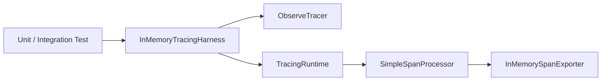

# `@aldok10/nestjs-observe-tracing-testing`

In-memory tracing test harness for `@aldok10/nestjs-observe-tracing`.

## Overview

`@aldok10/nestjs-observe-tracing-testing` provides `InMemoryTracingHarness`, a test helper that wires `TracingRuntime` and `ObserveTracer` to OpenTelemetry's `InMemorySpanExporter` and `SimpleSpanProcessor` for deterministic span assertions.

## Why This Package?

- **Zero boilerplate in tests**: Pre-configures `InMemorySpanExporter`, `SimpleSpanProcessor`, `TracingRuntime`, and `ObserveTracer` in a single constructor.
- **Clean isolation**: Provides `reset()` to clear captured spans between test cases and `shutdown()` for teardown.

## Features

- `InMemoryTracingHarness` exposing `exporter`, `runtime`, and `tracer`.
- `getSpans()` returning `readonly ReadableSpan[]` synchronously after span completion.
- `reset()` to clear recorded spans and `shutdown()` to tear down `TracingRuntime`.

## Architecture and Responsibilities



## Installation

```bash
pnpm add -D @aldok10/nestjs-observe-tracing-testing
```

```bash
npm install -D @aldok10/nestjs-observe-tracing-testing
```

```bash
yarn add -D @aldok10/nestjs-observe-tracing-testing
```

## Requirements

- **Node.js**: `>=22`
- **Peer Dependencies**: None
- **Module Formats**: ESM (`import`), CJS (`require`), and TypeScript declarations (`.d.ts`).

## Quick Start

```ts
import { afterEach, describe, expect, it } from 'vitest';
import { InMemoryTracingHarness } from '@aldok10/nestjs-observe-tracing-testing';

describe('Orders', () => {
  let harness: InMemoryTracingHarness | undefined;

  afterEach(async () => {
    await harness?.shutdown();
    harness = undefined;
  });

  it('records order.create span', async () => {
    harness = new InMemoryTracingHarness({ resource: { serviceName: 'orders-test' } });
    await harness.tracer.withSpan('order.create', async () => 'ok');

    expect(harness.getSpans().map((s) => s.name)).toEqual(['order.create']);
  });
});
```

## Configuration

### `InMemoryTracingHarness` Constructor Options

| Property         | Type               | Required | Default     | Description                                                                         |
| ---------------- | ------------------ | -------- | ----------- | ----------------------------------------------------------------------------------- |
| `resource`       | `ResourceMetadata` | No       | `undefined` | Optional resource metadata passed to `TracingRuntime`.                              |
| `registerGlobal` | `boolean`          | No       | `true`      | Whether `TracingRuntime` registers global OpenTelemetry `trace` and `context` APIs. |

## Usage

```ts
const harness = new InMemoryTracingHarness({ registerGlobal: false });
await harness.tracer.withSpan('op.one', async () => 1);
expect(harness.getSpans()).toHaveLength(1);

harness.reset();
expect(harness.getSpans()).toHaveLength(0);

await harness.shutdown();
```

## Advanced Usage

Access `harness.exporter` directly for `InMemorySpanExporter` methods or `harness.runtime` to test `flush()`, `health()`, or NestJS integration.

## API Reference

- `InMemoryTracingHarness`:
  - `readonly exporter: InMemorySpanExporter`
  - `readonly runtime: TracingRuntime`
  - `readonly tracer: ObserveTracer`
  - `getSpans(): readonly ReadableSpan[]`
  - `reset(): void`
  - `shutdown(): Promise<void>`

## Integration with Other Packages

- Built on [`@aldok10/nestjs-observe-core`](../../core/README.md) and [`@aldok10/nestjs-observe-tracing`](../tracing/README.md).

## Dependencies and Optional Integrations

- **Runtime dependencies**: `@aldok10/nestjs-observe-core`, `@aldok10/nestjs-observe-tracing`, `@opentelemetry/sdk-trace`.

## Lifecycle and Resource Management

- `new InMemoryTracingHarness()` calls `this.runtime.initialize()` immediately.
- Always call `await harness.shutdown()` (for example in `afterEach`) to release `AsyncLocalStorageContextManager` and reset global OpenTelemetry providers when `registerGlobal` is `true`.

## Error Handling

- Propagates any errors from `TracingRuntime.shutdown()`.

## Performance Considerations

- Uses `SimpleSpanProcessor` so spans are immediately available in `getSpans()` without waiting for batch timers; intended for tests only.

## Security Considerations

- Intended for test environments; do not use `InMemoryTracingHarness` in production code.

## Testing

```bash
pnpm test
```

```bash
pnpm exec vitest run packages/traces/testing
```

## Troubleshooting

- **Global provider conflicts between test files**: Ensure `await harness.shutdown()` runs in `afterEach`, or pass `{ registerGlobal: false }` when testing `harness.tracer` directly.

## Limitations

- Captures spans in memory only; does not export over network or test OTLP serialization.

## Related Packages

- [`@aldok10/nestjs-observe-tracing`](../tracing/README.md)
- [`@aldok10/nestjs-observe-metrics-testing`](../../metrics/testing/README.md)

## Documentation

- [Traces Domain Guide](../../../docs/packages/traces/README.md)

## Contributing

See [CONTRIBUTING.md](../../../CONTRIBUTING.md).

## License

MIT — see [LICENSE](../../../LICENSE).
