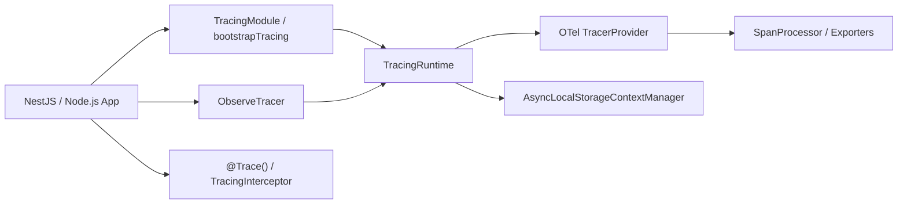

# `@aldok10/nestjs-observe-tracing`

Standalone OpenTelemetry distributed tracing runtime, tracer service, method decorator, interceptor, and NestJS dynamic module.

## Overview

`@aldok10/nestjs-observe-tracing` provides a self-contained distributed tracing layer built on `@opentelemetry/sdk-trace` and `@opentelemetry/api`. It can be bootstrapped standalone with `bootstrapTracing()` or integrated into a NestJS application via `TracingModule.forRoot()` and `TracingModule.forRootAsync()`, with automatic lifecycle teardown on shutdown.

## Why This Package?

- **Standalone or NestJS-native**: Use `TracingRuntime` and `ObserveTracer` directly in plain Node.js scripts or workers, or wire them into NestJS DI with `TracingModule`.
- **Managed lifecycle**: `TracingRuntime` implements `LifecycleParticipant` from `@aldok10/nestjs-observe-core` with bounded flush and shutdown timeouts (`BoundedExecution`), and `TracingLifecycleService` hooks into NestJS `OnModuleDestroy` and `OnApplicationShutdown`.
- **Ergonomic span APIs**: `ObserveTracer` provides `withSpan`, `startSpan`, `withBaggage`, `getTraceContext`, and active-span helpers, alongside `@Trace()` and `TracingInterceptor`.

## Features

- `TracingRuntime` and `bootstrapTracing()` for configuring `TracerProvider`, `AsyncLocalStorageContextManager`, samplers, and span processors.
- `TracingModule` (`forRoot` and `forRootAsync` with `useFactory`, `useClass`, or `useExisting`).
- `ObserveTracer` injectable service for manual and callback-scoped spans, attributes, events, exceptions, trace context snapshots, and W3C baggage helpers.
- `@Trace()` method decorator supporting both synchronous and Promise-returning methods with automatic status and exception recording.
- `TracingInterceptor` NestJS interceptor for creating spans around controller or handler execution.
- Configurable sampling (`always_on`, `always_off`, `ratio` with optional `parentBased`, or a custom OpenTelemetry `Sampler`).

## Architecture and Responsibilities



- **`TracingRuntime`**: Owns `TracerProvider`, `AsyncLocalStorageContextManager`, global registration, bounded `flush()`, `shutdown()`, and `health()`.
- **`TracingModule` & `TracingLifecycleService`**: Registers `TRACING_OPTIONS`, `TRACING_RUNTIME`, `ObserveTracer`, and `TracingInterceptor`, and ensures idempotent shutdown.
- **`ObserveTracer`**: Wraps `@opentelemetry/api` `trace`, `context`, and `propagation` for application code.
- **`@Trace()` & `TracingInterceptor`**: Declarative method and NestJS handler instrumentation using the global OpenTelemetry tracer.

## Installation

```bash
pnpm add @aldok10/nestjs-observe-tracing @nestjs/common @nestjs/core reflect-metadata
```

```bash
npm install @aldok10/nestjs-observe-tracing @nestjs/common @nestjs/core reflect-metadata
```

```bash
yarn add @aldok10/nestjs-observe-tracing @nestjs/common @nestjs/core reflect-metadata
```

Optional peer integration: `rxjs` (used at runtime by `TracingInterceptor` to hook observable completion and errors).

## Requirements

- **Node.js**: `>=22`
- **Peer Dependencies**:
  - `@nestjs/common`: `^10.0.0 || ^11.0.0 || ^12.0.0`
  - `@nestjs/core`: `^10.0.0 || ^11.0.0 || ^12.0.0`
  - `reflect-metadata`: `^0.1.12 || ^0.2.0`
- **Module Formats**: ESM (`import`), CJS (`require`), and TypeScript declarations (`.d.ts`).

## Quick Start

```ts
import { Module } from '@nestjs/common';
import { TracingModule } from '@aldok10/nestjs-observe-tracing';
import { createConsoleSpanProcessor } from '@aldok10/nestjs-observe-tracing-exporter-console';

@Module({
  imports: [
    TracingModule.forRoot({
      resource: { serviceName: 'orders-api', environment: 'development' },
      spanProcessors: [createConsoleSpanProcessor()],
    }),
  ],
})
export class AppModule {}
```

## Configuration

### `TracingOptions`

| Property            | Type                               | Required | Default                                         | Description                                                                           |
| ------------------- | ---------------------------------- | -------- | ----------------------------------------------- | ------------------------------------------------------------------------------------- |
| `resource`          | `ResourceMetadata`                 | No       | `undefined`                                     | Service resource metadata converted via `toSemanticResourceAttributes`.               |
| `sampler`           | `Sampler \| TracingSamplingConfig` | No       | `ParentBasedSampler({ root: AlwaysOnSampler })` | Sampling strategy config or custom OpenTelemetry `Sampler` instance.                  |
| `spanProcessors`    | `readonly SpanProcessor[]`         | No       | `[]`                                            | Span processors attached to the `TracerProvider`.                                     |
| `registerGlobal`    | `boolean`                          | No       | `true`                                          | Registers global `AsyncLocalStorageContextManager` and `TracerProvider`.              |
| `shutdownTimeoutMs` | `number`                           | No       | `undefined`                                     | Default timeout (ms) applied to `flush()` and `shutdown()` via `BoundedExecution`.    |
| `diagnostics`       | `DiagnosticsSink`                  | No       | `NoopDiagnosticsSink`                           | Sink for internal lifecycle/warn/error diagnostic events.                             |
| `global`            | `boolean`                          | No       | `true`                                          | Whether `TracingModule.forRoot` / `forRootAsync` registers as a NestJS global module. |

### `TracingSamplingConfig`

| Variant                                      | Fields                                   | Description                                                                                        |
| -------------------------------------------- | ---------------------------------------- | -------------------------------------------------------------------------------------------------- |
| `{ strategy: 'always_on' }`                  | —                                        | Samples every root and child span (`AlwaysOnSampler`).                                             |
| `{ strategy: 'always_off' }`                 | —                                        | Drops all spans (`AlwaysOffSampler`).                                                              |
| `{ strategy: 'ratio', ratio, parentBased? }` | `ratio: number`, `parentBased?: boolean` | `TraceIdRatioBasedSampler(ratio)`, wrapped in `ParentBasedSampler` unless `parentBased === false`. |

### `TraceDecoratorOptions`

| Property          | Type         | Required | Default                      | Description                                                     |
| ----------------- | ------------ | -------- | ---------------------------- | --------------------------------------------------------------- |
| `name`            | `string`     | No       | `'<ClassName>.<methodName>'` | Custom span name.                                               |
| `kind`            | `SpanKind`   | No       | `undefined`                  | OpenTelemetry `SpanKind`.                                       |
| `attributes`      | `Attributes` | No       | `undefined`                  | Initial span attributes.                                        |
| `recordException` | `boolean`    | No       | `true`                       | Whether thrown/rejected errors are recorded as span exceptions. |

## Usage

### Injecting `ObserveTracer`

```ts
import { Injectable } from '@nestjs/common';
import { ObserveTracer } from '@aldok10/nestjs-observe-tracing';

@Injectable()
export class OrdersService {
  constructor(private readonly tracer: ObserveTracer) {}

  async createOrder(orderId: string): Promise<string> {
    return this.tracer.withSpan('order.create', async () => {
      this.tracer.setAttribute('order.id', orderId);
      this.tracer.addEvent('order.validated');
      return orderId;
    });
  }
}
```

### Using `@Trace()` Decorator

```ts
import { Injectable } from '@nestjs/common';
import { Trace } from '@aldok10/nestjs-observe-tracing';

@Injectable()
export class PaymentService {
  @Trace('payment.charge')
  async charge(amount: number): Promise<number> {
    return amount;
  }
}
```

### Standalone Bootstrap

```ts
import { ObserveTracer, bootstrapTracing } from '@aldok10/nestjs-observe-tracing';

const runtime = bootstrapTracing({ resource: { serviceName: 'worker' } });
const tracer = new ObserveTracer(runtime);

await tracer.withSpan('job.run', async () => {
  // work
});

await runtime.shutdown();
```

## Advanced Usage

### Async NestJS Configuration (`forRootAsync`)

```ts
import { Module } from '@nestjs/common';
import { TracingModule } from '@aldok10/nestjs-observe-tracing';

@Module({
  imports: [
    TracingModule.forRootAsync({
      useFactory: () => ({
        resource: { serviceName: 'billing-api' },
        sampler: { strategy: 'ratio', ratio: 0.1, parentBased: true },
      }),
    }),
  ],
})
export class AppModule {}
```

### Baggage and Trace Context Snapshots

```ts
const snapshot = tracer.getTraceContext(); // { traceId, spanId, traceFlags }
await tracer.withBaggage({ tenant: 'acme' }, async () => {
  const tenant = tracer.getBaggageEntry('tenant');
});
```

### NestJS `TracingInterceptor`

Apply `TracingInterceptor` globally or per-controller/route. It creates a `SpanKind.INTERNAL` span named `<ClassName>.<handlerName>` with `code.namespace` and `code.function` attributes.

## API Reference

- **Classes**: `TracingRuntime`, `ObserveTracer`, `TracingModule`, `TracingLifecycleService`, `TracingInterceptor`
- **Functions**: `bootstrapTracing(options?)`, `Trace(nameOrOptions?)`
- **DI Tokens**: `TRACING_OPTIONS`, `TRACING_RUNTIME`, `OBSERVE_TRACER` (alias for `ObserveTracer`)
- **Types**: `TracingOptions`, `TracingSamplingConfig`, `SpanOptions`, `TraceContextSnapshot`, `TraceDecoratorOptions`, `TracingAsyncOptions`, `TracingOptionsFactory`

## Integration with Other Packages

- Pair with [`@aldok10/nestjs-observe-tracing-exporter-otlp`](../exporter-otlp/README.md) or [`@aldok10/nestjs-observe-tracing-exporter-console`](../exporter-console/README.md) for `spanProcessors`.
- Add HTTP auto-instrumentation with [`@aldok10/nestjs-observe-tracing-instrumentation-http`](../instrumentation-http/README.md) and data-layer semantic helpers with [`@aldok10/nestjs-observe-tracing-instrumentation-data`](../instrumentation-data/README.md).
- For unified logs, metrics, and traces setup, see [`@aldok10/nestjs-observe`](../../observer/observer/README.md).

## Dependencies and Optional Integrations

- **Runtime dependencies**: `@aldok10/nestjs-observe-core`, `@opentelemetry/api`, `@opentelemetry/context-async-hooks`, `@opentelemetry/resources`, `@opentelemetry/sdk-trace`.
- **Optional runtime peer**: `rxjs` loaded dynamically via `tryLoadOptionalPeer('rxjs')` inside `TracingInterceptor`.

## Lifecycle and Resource Management

- Calling `TracingRuntime.initialize()` more than once is a safe no-op that emits a `warn` diagnostic event.
- `TracingRuntime.shutdown(timeoutMs?)` is idempotent (caches the shutdown promise), runs `provider.shutdown()` through `BoundedExecution`, disables global `trace` and `context` APIs when `registerGlobal !== false`, and disables the `AsyncLocalStorageContextManager`.
- `TracingLifecycleService` calls `runtime.shutdown()` once across `onModuleDestroy` and `onApplicationShutdown`.

## Error Handling

- `TracingModule.forRootAsync` throws `InvalidConfigurationException` (from `@aldok10/nestjs-observe-core`) if none of `useFactory`, `useClass`, or `useExisting` is provided.
- `ObserveTracer.withSpan` and `@Trace()` normalize non-`Error` thrown values with `new Error(String(error))`, record the exception on the span, set `SpanStatusCode.ERROR`, end the span, and rethrow.

## Performance Considerations

- Prefer `BatchSpanProcessor` (provided by `@aldok10/nestjs-observe-tracing-exporter-otlp`) over `SimpleSpanProcessor` in production to avoid synchronous export overhead per span.
- Use `sampler: { strategy: 'ratio', ratio: ... }` to control trace volume in high-throughput services.

## Security Considerations

- Avoid placing PII, credentials, or raw request secrets in span attributes or baggage entries, as baggage propagates across service boundaries and span attributes are exported to collectors.

## Testing

Run the unit tests for this package:

```bash
pnpm test
```

```bash
pnpm exec vitest run packages/traces/tracing
```

For in-memory span assertions in your own test suites, see [`@aldok10/nestjs-observe-tracing-testing`](../testing/README.md).

## Troubleshooting

- **`@Trace()` or `TracingInterceptor` produces no spans**: Both call `trace.getTracer('@aldok10/nestjs-observe-tracing')` on the global OpenTelemetry API. Ensure `registerGlobal` is not `false` (default is `true`) and `TracingRuntime` is initialized before decorated methods execute.
- **`TracingInterceptor` ends spans immediately**: Ensure `rxjs` is installed and resolvable so `TracingInterceptor` can hook `tap({ error, complete })`.

## Limitations

- `TracingInterceptor` uses `tracer.startSpan(...)` rather than `startActiveSpan(...)`, so the span it creates is not bound as the active context for downstream calls inside the handler.
- `TracingInterceptor` requires `rxjs` at runtime to wait for observable completion; without `rxjs`, the span ends immediately when `intercept()` returns.

## Related Packages

- [`@aldok10/nestjs-observe-core`](../../core/README.md)
- [`@aldok10/nestjs-observe-tracing-exporter-otlp`](../exporter-otlp/README.md)
- [`@aldok10/nestjs-observe-tracing-exporter-console`](../exporter-console/README.md)
- [`@aldok10/nestjs-observe-tracing-instrumentation-http`](../instrumentation-http/README.md)
- [`@aldok10/nestjs-observe-tracing-instrumentation-data`](../instrumentation-data/README.md)
- [`@aldok10/nestjs-observe-tracing-testing`](../testing/README.md)
- [`@aldok10/nestjs-observe`](../../observer/observer/README.md)

## Documentation

- [Traces Domain Guide](../../../docs/packages/traces/README.md)
- [Architecture Overview](../../../docs/architecture/overview.md)
- [Dependencies](../../../docs/architecture/dependency-graph.md)

## Contributing

See [CONTRIBUTING.md](../../../CONTRIBUTING.md).

## License

MIT — see [LICENSE](../../../LICENSE).
